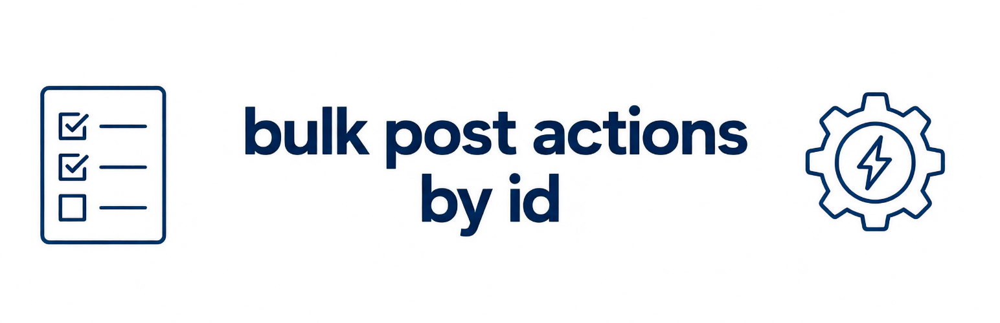

# Bulk Post Actions by ID

  

## Быстрое управление статусом записей по списку ID

**Bulk Post Actions by ID** — легкий и безопасный инструмент для массового изменения статуса записей в WordPress. Позволяет мгновенно перевести группу постов в черновики, на модерацию или в корзину, просто указав их ID.

[Описание](#о-плагине) · [Возможности](#возможности) · [Установка](#установка) · [Использование](#использование)

---

## О плагине

Стандартные инструменты WordPress требуют выделения записей в общем списке, что неудобно при работе с сотнями постов или при наличии конкретных ID из внешних отчетов. Этот плагин решает задачу точечно: вы вводите список ID, выбираете действие, и плагин выполняет его за секунды.

Меню плагина удобно расположено в самом первом разделе админ-панели — **"Консоль"**, что обеспечивает мгновенный доступ к инструменту.

---

## Возможности

*   **Гибкий ввод:** Поддерживает ввод ID через запятую, пробел или с новой строки.
*   **Три режима работы:** Перевод в черновики (draft), на модерацию (pending) или в корзину (trash).
*   **Безопасность:** Строгая проверка прав доступа (`manage_options`), защита форм через WordPress Nonce и полная санитизация входящих данных.
*   **Детальный отчет:** После выполнения показывает количество успешно обработанных записей и список их ID, а также сообщает об ошибках, если ID не найден.
*   **Легковесность:** Никакой лишней нагрузки на базу данных, используются стандартные функции `wp_update_post`.

---

## Установка

1. Скачайте ZIP-архив из раздела **Releases**.
2. Перейдите в админке WordPress: **Плагины → Добавить новый → Загрузить плагин**.
3. Выберите файл `bulk-post-actions-by-id.zip` и нажмите **Установить**.
4. Активируйте плагин.
5. Перейдите в раздел **Консоль → Массовые действия** для начала работы.

---

## Использование

1. Откройте **Консоль → Массовые действия**.
2. Вставьте список ID записей в текстовое поле (например: `123, 124, 125` или каждый с новой строки).
3. Выберите нужное действие (Черновик, Ожидание или Корзина).
4. Нажмите кнопку **Выполнить действие**.
5. Проверьте отчет об успехе или ошибках в верхней части страницы.

---

## Лицензия

Copyright © 2024 Elizarov_n906

Этот плагин распространяется под лицензией **GNU General Public License v2 (GPLv2)**.  
Это означает, что вы можете свободно использовать, изменять и распространять плагин при условии сохранения открытости исходного кода.

   
  Разработано — <a href="https://github.com/elizarov-n906">Elizarov_n906</a>

